

  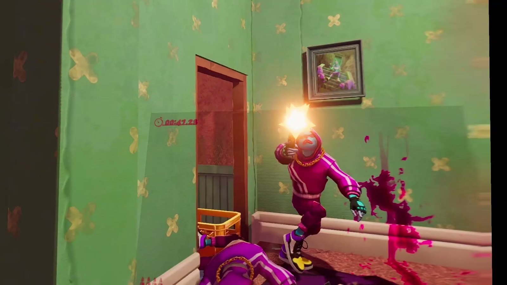

<h1 align="center">Anger Foot VR</h1>

  <b>Kick down every door yourself.</b> 
  A free PC VR mod for <i>Anger Foot</i>: your own body, your own kicks, guns in your hands, and a neon movie house to
  hang out in between levels.

  <a href="../../releases/latest"><b>Download</b></a> &nbsp;|&nbsp;
  <a href="#install">Install</a> &nbsp;|&nbsp;
  <a href="#controls">Controls</a> &nbsp;|&nbsp;
  <a href="../../issues">Report a bug</a> &nbsp;|&nbsp;
  <a href="https://ko-fi.com/strikezonevr">Support on Ko-fi</a>

> **PC VR only.** The game runs on your PC and streams to your headset (Virtual Desktop, Quest Link / Air Link,
> Steam Link or SteamVR). It does **not** run standalone on a Quest.

---

## What it does

### Your body
- The whole game in VR with **Anger Foot's own hero model** as your body: head, arms, hands and legs follow you,
  feet planted, knees bending.
- Your fingers follow the controllers: trigger finger, fist and thumb.
- **Click the right stick to flip enemies off.** The ones who see it come for you.

  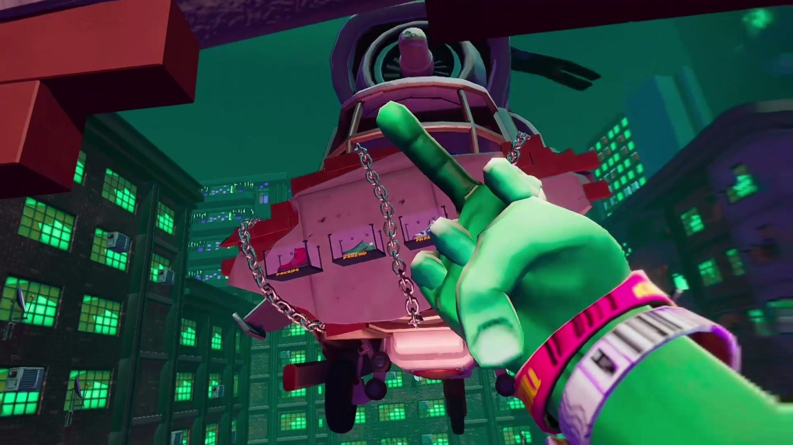
  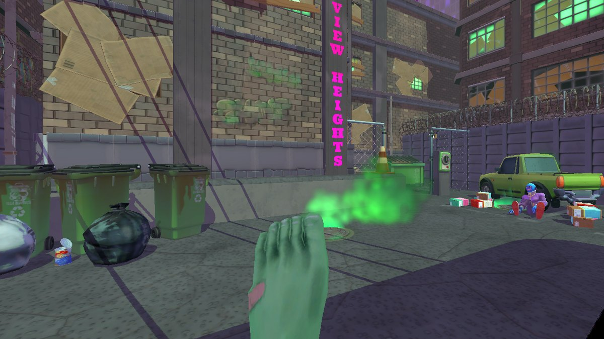

### Kicks
- **B or X kicks**: a head-high front kick, the knee up first and then the snap, like the game's own.
- Jump and kick on the move for the game's **flying double kick**, jump in place for a **roundhouse**, look down to
  **stomp**. Doors explode, enemies fly.

### Guns
- Every gun sits in your hand, **gripped the way the game's own hand holds it** (recoil and reloads too), aimed with
  your controller and fired from the muzzle.
- **Two-handed guns** (rifles, shotgun, sniper, crossbow, launcher, flamethrower, minigun): put your other hand on the
  front and squeeze to hold it with both.
- **Dual pistols:** one in each hand, each trigger fires its own.
- **The sniper rifle has a working scope:** put your eye to it.
- An **ammo count** on the back of every gun, flashing EMPTY when it's time to throw it.
- **Throw for real:** hold the gun hand's grip, swing and let go. It flies the way your hand was going (steadied by
  where you look), as hard as you threw it, spinning off your wrist, with a gentle aim assist. Let go without a swing
  and it goes where it points. Waving your hands about never throws it. New in 1.2: the swing is read more steadily,
  soft lobs stay soft, and a throw you let go of mid-reload goes as soon as the game can throw.
- **Set the grip yourself** (new in 1.2): turn on **GUN GRIP ADJUST** (VR tab or the launcher),
  hold a gun and set how it sits in your hand, live. The gun hand's stick tilts and turns it (click the stick for
  height, then depth and roll; hold the click to put it back), or squeeze your other hand's grip on the gun and place
  it by hand. Each gun keeps its own. Turn it off when you're done: it borrows that stick.

  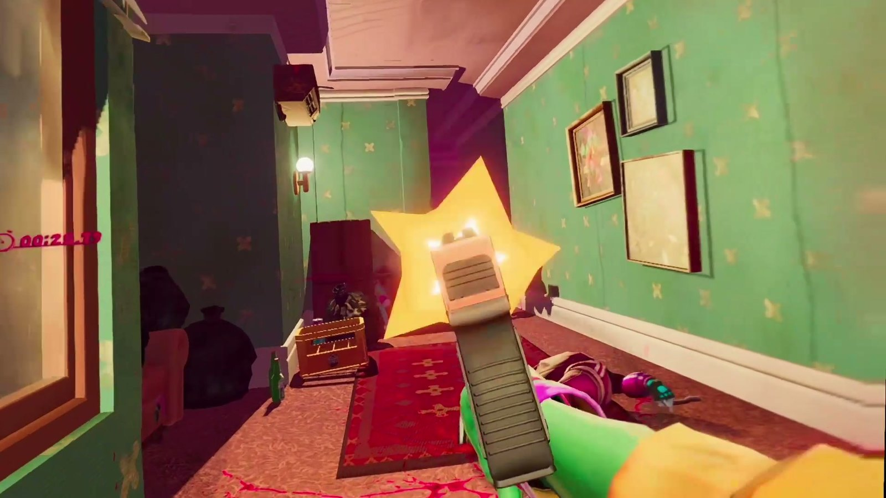
  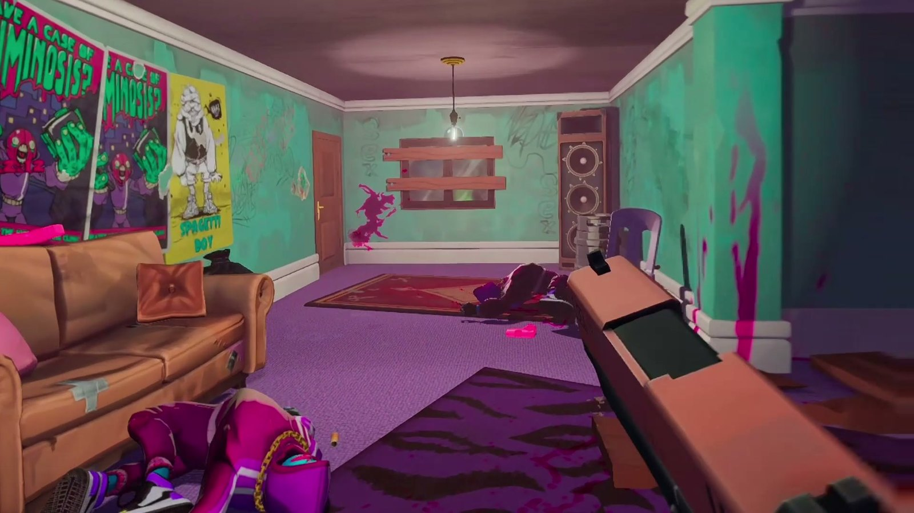

  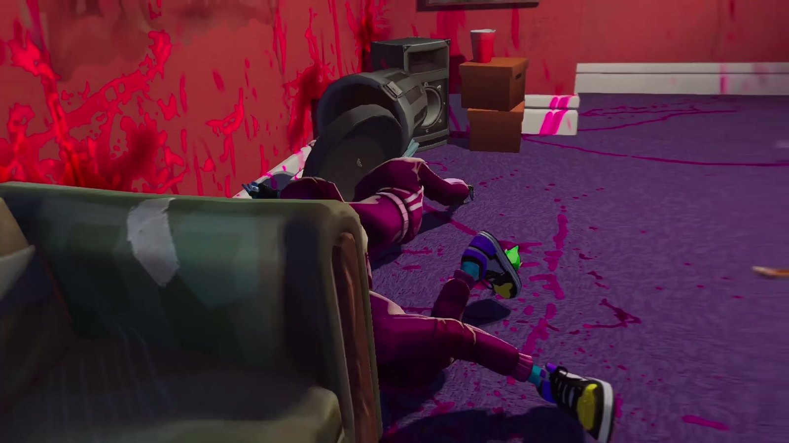
  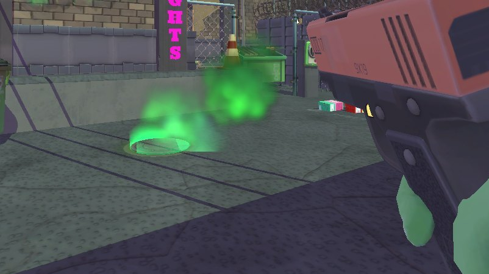

### Your hands
- **Reach for (or point at)** drinks, bottles, the lizard, doors and buttons with your free hand and squeeze its grip.
  Looking at them still works too.
- **Drink for real:** bring the bottle to your mouth.
- Haptics for shots, kicks, doors, hits, throws and shoe powers.

### Gore (new in 1.1: The Gore Update)
- **GORE: EXTRA** (the default) builds on the game's own blood:
  - kicks splatter the wall behind the goon, and kicking a body makes it bleed;
  - **headshot kills pop heads**, with a fountain from the neck (not bosses, and not the goons whose heads are
    special);
  - bullet wounds spurt and stay on the goon, going down with them;
  - bodies leave smears where they slam into walls and floors, and pools of blood stain the bodies lying in them;
  - explosions spray blood all round;
  - **holes** (new in 1.2): shoot a goon and the bullet goes right through, a cartoon hole you can see through, bigger
    for bigger guns (a shotgun up close blows a big one). Explosions take a bite out of them;
  - **blood on you** (more of it in 1.2): kills close by spatter your chest, arms, hands and legs (a bloody kick your
    shoe), drying off and gone after 15 seconds.
- **BLOOD COLOUR:** the game's own pink, or red.
- **GORE: GAME** is the game's own blood as it is, **OFF** turns blood off. The game's own **Show Blood** setting still
  decides whether there's any.
- The blood splats land on walls and floors properly in VR, each eye its own.

  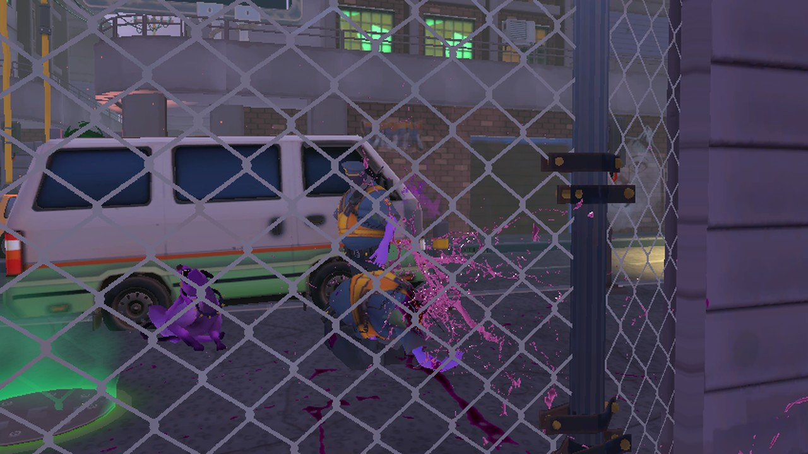
  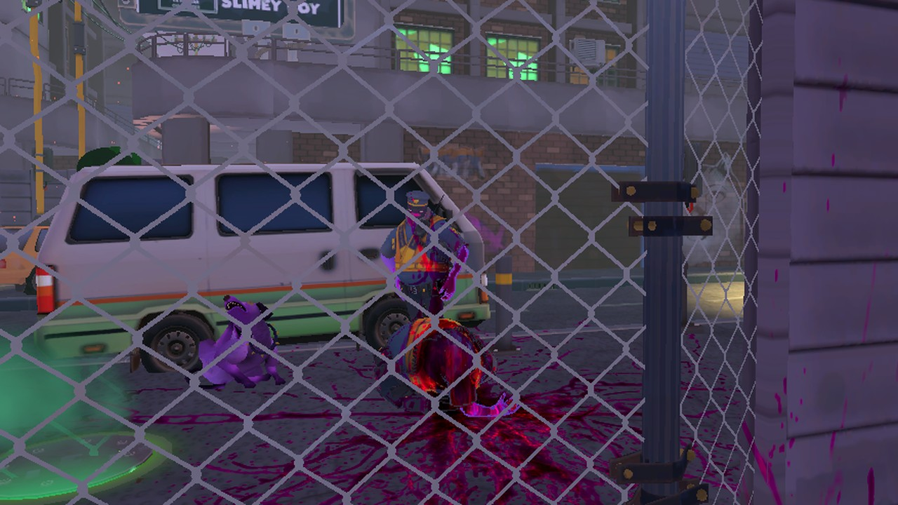

### The Movie House
- A neon picture palace built for the mod, where the game's menus and cutscenes play on the big screen. Point a laser
  from either hand to click them and to scroll lists (or hold the trigger and drag).
- Walk the aisle and check the **Hall of Fame** on the back wall: your levels, stars and best time.
- Kick open the padded doors into the **RAGE ROOM** and smash TVs, a jukebox, a fish tank and more. It keeps score.
- A short VR opening where the lights bang on (first start only, or turn it off).

  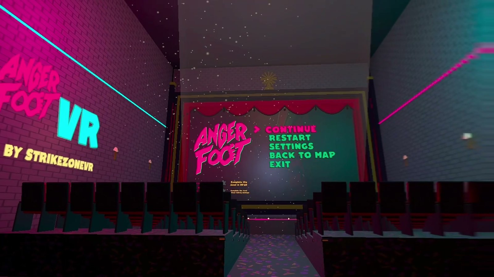
  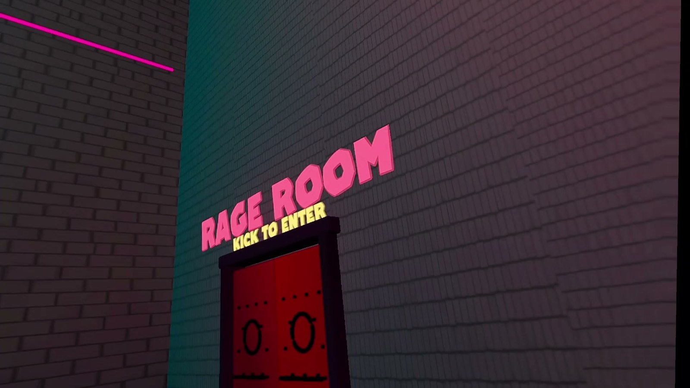

### The level select, in the car
- Sit in the car with the map book on your lap and **point at a level** to see its card, then pull the trigger: the
  card shows the level's **star goals** and your best time.
- Want the star goals in view while you play too? Turn on the game's own **Show Goals** (SETTINGS, Gameplay).
- Press **Y** for your shoes.

  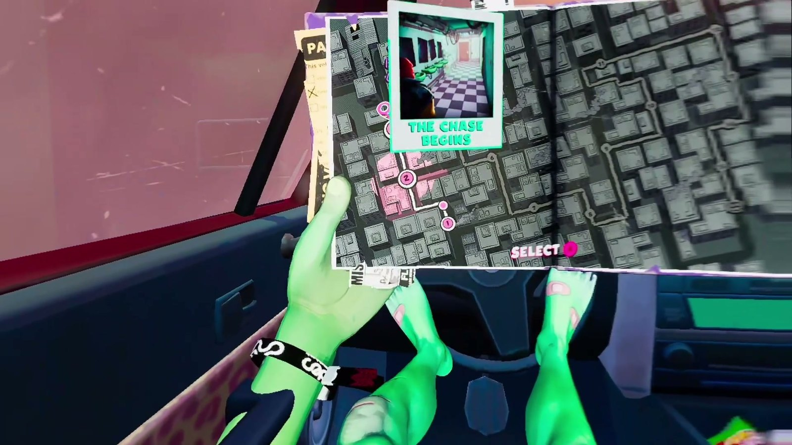
  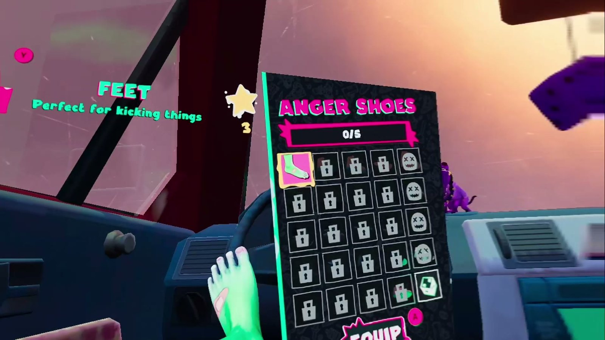

### Settings and comfort
- **A VR tab in the game's own SETTINGS** (the headset icon) with every VR option and what it does, and every option
  in the launcher too.
- Snap or smooth turning, recenter any time (hold the left stick), gun hand right or left.
- A steady spectator view on your monitor for streaming and recording, with its own field of view. New in 1.2:
  **BEHIND YOU** shows you from over your shoulder, your whole body and all, for anyone watching (off by default; it
  costs a few frames).
- Tuned to run well on 6 GB laptop GPUs.

  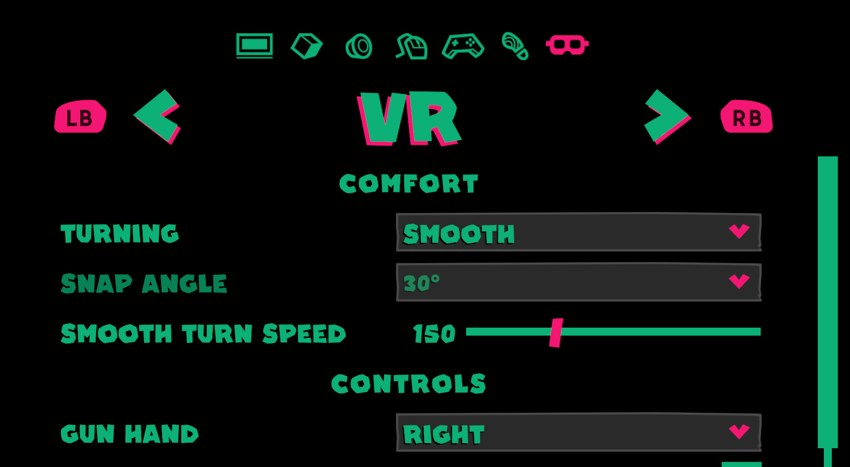

### The launcher
- Its own launcher: one-click install, a VR check, every option, the controls card and uninstall.
- Your saves are never touched.

## What you need

- **Anger Foot** on Steam (PC).
- A **PC VR headset**: Quest 2 / 3 / Pro through Virtual Desktop, Quest Link / Air Link or Steam Link, or a SteamVR
  headset (Index, Vive, Windows Mixed Reality).
- An internet connection the first time: the launcher downloads Unity's VR plugin from Unity.

## Install

1. Download `AngerFootVR-v1.2.0.zip` from the [latest release](../../releases/latest).
2. Find your game folder: in Steam, right-click **Anger Foot**, **Manage**, **Browse local files**.
3. Unzip the zip **into that folder**, so `Anger Foot VR.exe` sits next to `Anger Foot.exe`.
4. Run **Anger Foot VR.exe**. If Windows says "Windows protected your PC", click **More info**, then **Run anyway**
   (the launcher isn't signed).
5. Start your VR app (Virtual Desktop, the Meta Quest app or SteamVR), then press **PLAY IN VR**. The first time, it
   installs the mod (BepInEx and the mod) before starting the game.

If the game starts on the wrong VR app, pick yours in the launcher: **OPTIONS**, **VR RUNTIME**. The **VR CHECK** page
shows what the mod sees.

## Controls

Quest / Touch controllers; Index, Vive and Windows Mixed Reality controllers are mapped too.

| | Left hand | Right hand |
|---|---|---|
| Stick | move | turn (snap or smooth) |
| Stick click | hold: recenter | the middle finger |
| X / B | kick | kick |
| Y / A | shoe power (in the car: shoes) | jump |
| Trigger | second pistol | shoot |
| Grip | grab or use what your hand is on; hold the front of a two-handed gun | hold and let go: throw your gun |
| Menu | pause | |

**Menus:** in the movie house, point at the screen and pull the trigger; lists scroll with the right stick while you
point at them. In the car, point at the map. Elsewhere, the stick moves, A selects and B goes back; the grips change
settings tabs.

The gun hand can be switched to the left in the settings.

## If something looks wrong

| Problem | Fix |
|---|---|
| The game starts on the wrong VR app | Launcher: **OPTIONS**, **VR RUNTIME**, and pick yours. |
| Your antivirus flags `winhttp.dll` | That's BepInEx's mod loader. Allow it. |
| You're facing the wrong way, or off-centre | Hold the left stick in to recenter. |
| Smooth turning makes you queasy | SETTINGS, VR: **TURNING** to SNAP. |
| You'd rather pick levels on the big screen | SETTINGS, VR: turn off **LEVEL SELECT IN THE CAR**. |
| Too much blood (or not enough) | SETTINGS, VR: **GORE** to GAME or OFF, or back to EXTRA. |
| It stutters | Lower the game's own graphics settings (shadows, effects), and close other apps using the GPU. |

## Reporting a bug

Bug reports help a lot. [Open an issue](../../issues/new) and attach:

- your log: in the launcher, **VR CHECK**, **GAME LOG** (it's `BepInEx\LogOutput.log` in the game folder). Close the
  game first.
- where in the game it happened, plus a short clip or a description;
- your headset and how you connect it (Virtual Desktop, Quest Link, Steam Link or SteamVR).

## Uninstall

Run **Anger Foot VR.exe**, open **VR CHECK** and press **UNINSTALL** (twice: it asks to be sure). The game folder goes
back to how it was. Your saves are never touched.

## Building from source

- The .NET SDK (6 or later), and Git Bash to run the scripts in `tools/`.
- The game, installed: set `AFVR_GAME_DIR` to its folder (the build and the scripts both read it).
- [BepInEx 5.4](https://github.com/BepInEx/BepInEx/releases) (Windows x64), unzipped into `vendor/bepinex`: the build
  references its core libraries and the package ships them.
- `dotnet build src/AngerFootVR.Plugin -c Release` builds the mod; `tools/package.sh` builds the launcher, the payload
  and the release folder in `dist/`.

How it works inside is in [PLAN.md](PLAN.md). `tools/vr-start.sh` runs the game against Unity's OpenXR mock runtime,
so most things can be tested without a headset; the 3D props are built in Blender by the scripts in `tools/blender`.

## Credits

- **StrikeZoneVR**: Anger Foot VR.
- The open-source parts:
  - [BepInEx](https://github.com/BepInEx/BepInEx) 5 (LGPL-2.1), with [HarmonyX](https://github.com/BepInEx/HarmonyX)
    (MIT)
  - Unity's [OpenXR plugin](https://docs.unity3d.com/Packages/com.unity.xr.openxr@latest), downloaded from Unity by
    the launcher, not bundled
  - the [Bungee](https://fonts.google.com/specimen/Bungee) and [Neonderthaw](https://fonts.google.com/specimen/Neonderthaw)
    fonts (SIL Open Font License)

If Anger Foot VR made you kick a few extra doors, you can [support it on Ko-fi](https://ko-fi.com/strikezonevr).
Thank you!

## License

[GPL-3.0](LICENSE). Copyright (C) 2026 StrikeZoneVR.
The bundled libraries keep their own licenses.

*Anger Foot is a game by Free Lives, published by Devolver Digital. Anger Foot VR is an unofficial, fan-made mod. It
is not affiliated with or endorsed by Free Lives or Devolver Digital, and it does not include any game files: the
launcher and the mod read the game's art, music and models from your own copy at run time. You need your own copy of
the game.*
